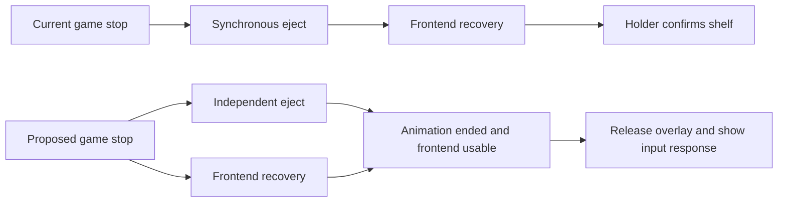

# Precision and responsiveness implementation proposal

**2026-10-16 scope update:** the user's new request makes independent slotting,
connected TV/handheld presentation, selected idle/action animation and recognizable
browse-stage models core work. See [the new presentation plan](SLOTTED_PRESENTATION_PLAN.md)
for the researched architecture, explicit interaction decisions and acceptance gates.
The accuracy and responsiveness requirements below continue to apply.

Refined and approved 2026-10-13. User-selected direction: **accurate hardware with restrained cel shading**. Baseline and feasibility implementation is underway; current evidence and limitations are in [IMPLEMENTATION_PROGRESS.md](IMPLEMENTATION_PROGRESS.md). Findings and historical measurements are in [IMPROVEMENT_ANALYSIS.md](IMPROVEMENT_ANALYSIS.md), and sources are in [FRONTEND_RESEARCH.md](FRONTEND_RESEARCH.md).

## Intended experience

Every console and cartridge should be identifiable by its proportions, silhouette, moulding and markings. Lighting should give the plastic and glass enough separation to read clearly on the RG34XXSP. Navigation responds immediately and flows through repeated presses. The final eject pose is the usable shelf. Gameplay previews occupy the intended physical surface through crop-only video mapping.

The theme should feel finished through consistent behavior across browsing, previews, launch, return, system selection and menus. Physical loading provides most of the animation. Small focus, lighting and sound effects support it.

## Decisions already settled

| Decision | Direction |
|---|---|
| Hardware | Source-backed proportions, revision-specific details and accurate printing |
| Style | Restrained cel shading; thinner outlines, controlled shadow bands and small material highlights |
| Video | Uniform scale and crop; preserve source display aspect ratio |
| PS1 | Gameplay over the complete CD face, outside circle clipped and physical center hole open |
| Default composition | Black background, opaque neighbouring media, top status |
| Preview behavior | Selected game only, silent, existing three-second delay and reset/toggle behavior |
| Existing systems | Improve the implemented families before adding new systems |
| Publication | Packaging follows the quality milestone |

## Questions the prototypes must resolve

These are engineering questions to answer after implementation starts. They do not require guessing a preference or changing the handheld during planning.

- Which part of the installed frontend's return path accounts for the gap after eject?
- Can ES recover under the native animation without display/context/input conflicts?
- Can the installed renderer apply an antialiased annular video shader with true transparency?
- Can a single active video component change its mask/crop for mixed regional cartridges?
- Is scroll stutter predominantly resource work, motion discontinuity, or a combination?
- How much native geometry and printing detail can be added while preserving frame pacing?

## Work structure

| Stage | Result | Exit condition |
|---|---|---|
| 0. Baseline | Reproducible device traces and exact installed-build information | Inputs, frame pacing and recovery stages are distinguishable |
| 1. Feasibility | Return-overlap, video-mask and precision exemplars | Each approach is demonstrated or rejected with evidence |
| 2. Responsiveness | Scroll and return fixes | Both meet input/motion criteria on representative systems |
| 3. Geometry contract | Shared profiles and shelf/native alignment | Region, pose, boundaries and physical loading agree |
| 4. PS1 and media videos | Full-disc preview, then other surface masks | Crop, transparency, lifecycle and mixed-variant checks pass |
| 5. Precision rollout | Accepted hardware/media revisions across all families | Reference comparisons and loading poses pass per family |
| 6. Product motion | Coherent sound, focus and cross-view transitions | Added animation preserves responsiveness and visual consistency |
| 7. Packaging | Documented install/update/uninstall and release assets | Full validation and publication preparation complete |

Stage 1 includes small DMG/PSP visual exemplars so the accuracy workflow can be judged early. Stage 3 is kept small: consolidate the geometry already required by the accepted prototypes, then expand through the rollout.

### Stage 0: establish a trustworthy baseline

Record OS/frontend/helper versions and hashes, active view and relevant settings, renderer backend, media sizes, library size and theme revision. Establish how the installed binary maps to available source; a matching version label alone is insufficient.

Begin with a large GBC or SNES shelf and a DS or PSP return. Add PS1 for video/display behavior. Capture single navigation taps, repeated taps, held input, reversal and wraparound, both before and during a preview. Compare first visits with warm revisits and the first navigation after a game.

Keep three measurements separate:

| Measurement | Method | What it establishes |
|---|---|---|
| Input-to-visible response | Timestamp one injected tap and its first visible effect | Whether the user can act and see the result |
| Motion continuity | Track cart position/scale over composed frames | Whether velocity/focus changes produce visible pulses |
| Internal/presented frame timing | Timestamp frontend stages and frame presentation when instrumentation is available | Where work stalls and how evenly frames are delivered |

The old changed-frame CRC sampler remains a regression tool. A composed recording may sample slower than the screen, and capture itself adds load; it cannot prove internal 60 Hz pacing. Frame intervals and motion velocity require their own evidence.

Start with externally observable timing and existing logs. Add the smallest diagnostic frontend build only where internal attribution is necessary, after identifying the relevant source revision. Do not begin by maintaining a broad frontend fork.

Baseline output: one short report with repeatable cases, timestamps, normal-versus-capture conditions and links to raw local evidence. Keep personal game art and device data outside publication assets.

### Stage 1A: prove a responsive return architecture

The target is clear: the visible end of eject should coincide with a shelf that accepts controls. The current saved DS/PSP timings suggest that eject and frontend recovery are largely serial. Shortening the 350 ms hold cannot account for the approximately 2.2 s gap after helper completion.

The second flow is a candidate architecture, not a proven implementation. Test it against these options in order:

| Option | Benefit | Required proof |
|---|---|---|
| Remove unnecessary synchronous work | Smallest change if cleanup/state/audio/resource work is the bottleneck | Timed evidence of reduced readiness delay without losing required updates |
| Detached eject overlapping ES restoration | Uses the existing independent display concept to recover underneath physical motion | Independent rendering survives restoration, no process pipe keeps configgen waiting, input ownership remains coherent |
| Narrow frontend readiness/recovery change | Supplies a reliable event and can defer nonessential work after the first usable frame | Correct source/build compatibility and preserved launch, save and input behavior |

The existing animation layer protects displayed pixels. It does **not** prove that the helper's SDL context, window or vsync remains safe while ES creates its own. The current native loop still calls SDL presentation and drains SDL events. Explicitly test that concurrent path; an offscreen/pbuffer rendering path may be needed if simultaneous window/display ownership fails.

A readiness contract should identify a launch/return generation and include:

- The game/configgen process has finished the necessary exit work.
- A valid shelf frame for this return has been presented.
- The frontend input lock has been released and controller processing is active.
- Eject has reached its final pose and the helper has stopped consuming controller events.

One coordinator owns the transition. A stale selection file or matching screenshot alone cannot signal all four conditions. Release the overlay promptly when the contract is satisfied so a new selection cannot change invisibly underneath it. A watchdog can release failed visual ownership, but must not report successful input readiness.

Test at least ten repeated returns for the selected stress system, plus rapid relaunch, a missing preview, video on/off and menu/cancel input. Schedule one controlled tap at several offsets around visible motion end in separate runs. Verify selection changes and visible movement; do not replay queued launch buttons or exit chords.

Success: no multi-second still shelf after motion finishes; a tap at motion completion is handled and visibly responds within the proposed 100 ms target. Also measure time from emulator exit, so making the animation artificially longer cannot count as an improvement.

### Stage 1B: prove crop and mask independently

Start with a synthetic square plane and an annulus, then fit the actual PS1 surface. Source inspection gives a concrete shader route: Knulli's shader interface exposes vertex position, video texture coordinates, output dimensions/offset and texture dimensions. These allow mask coordinates to be calculated independently of source cropping. Exact installed-build behavior remains a device question.

Test in this order:

1. Shader load and correct local coordinate orientation.
2. Uniform cover cropping for square-pixel 4:3, 16:9, square and vertical clips.
3. Antialiased outer circle and genuine transparent center hole over a contrasting background.
4. Alignment to the CD poster and the chosen shelf pose.
5. Existing delay, stop-on-navigation, missing-media and video-off states.
6. Shader compilation/first-play cost, warm playback and first play after a game.

Use analytic masks for circles and simple rounded shapes first. The examined shader interface establishes custom uniforms and the primary video sampler; it does not establish an arbitrary second mask-texture API. Complex contours should use a demonstrated analytic/polygon route or a narrowly scoped renderer extension. Avoid planning around an assumed PNG-mask input.

Measure blend behavior at the edge; choose straight or premultiplied alpha to match the actual renderer. Keep the center/background transparent and avoid dark fringe pixels. Check GLES precision and antialiasing support on the target device rather than relying on desktop results.

Success: full CD coverage and open bore, correct source proportions, no floating video after a selection change, and no new first-play hitch. If shader masking fails on the installed frontend, record the precise incompatibility and assess a focused enhancement. An opaque black circle cover is unsuitable as the final transparency solution.

### Stage 1C: establish the visual standard

Use **DMG plus its cartridge** to prove measured housing, exact printed identity and shelf/native alignment. Use **PSP-3000 plus UMD** to test curved silhouettes, shallow details, glass/plastic separation and a hinged enclosure.

Each exemplar needs:

- A specific hardware revision/region, reference images and a confidence-marked dimension/landmark sheet.
- Neutral front/rear/top/side views exposing geometry without stylised lighting.
- A native cel-shaded turntable or pose sheet at actual display size.
- Reference overlays at matched cameras, with written remaining discrepancies.
- First/last loading poses and a complete insertion/ejection sequence.
- Exported-native asset comparisons, not only attractive Blender previews.

Author an accurate master mesh, then derive a protected runtime mesh. Automatic simplification may affect interior/detail geometry; silhouette corners, characteristic curves, slot rims and hinge clearances get separate protection. Start within the current triangle budget, and change it only when device timing justifies the tradeoff.

Preferred visual treatment: a consistent soft key direction, gentle fill, muted outline, restrained shadow bands, accurate plastic colour and local highlights on LCD glass/metal. Preserve actual embossed detail. Avoid chunky black borders around printed ink, crushed lettering, broad glow, cartoon overshoot and altered housing proportions.

Use exact vector paths for recognisable marks where practical. Evaluate a small decal atlas for fine legends if geometric text consumes too much of the triangle budget. Texture support is a separate exporter/renderer decision: first prove the required detail and native cost, then choose its representation.

### Stage 2: fix navigation according to the traces

| Finding | First change to test | Acceptance |
|---|---|---|
| Cold-item decode/upload spikes | Bounded neighbour prefetch and simpler baked-item bindings | First visit approaches warm frame pacing without a growing memory cache |
| Warm repeated input pulses | Velocity-continuous carousel motion | Repeated taps/holds/reversals remain continuous and responsive |
| Brightness/focus snap | Focus value tied to visual motion progress | No abrupt selected/neighbor flash; selected brightness correct after return |
| Video transition spike | Hide playback immediately and remove lifecycle work from the navigation path where needed | First movement has equivalent responsiveness with preview on/off |

Choose a spring or equivalent continuous motion implementation only if the traces justify it. Preserve existing key-repeat and letter/page-jump semantics unless their behavior is independently shown to cause the issue. A rest-to-rest easing animation restarted at each repeat may still pulse at a stable frame rate.

Keep provisional scroll targets from the analysis: 60 Hz goal, p95 intervals at or below 20 ms, p99 at or below 33.3 ms during movement, and no repeatable stall above 50 ms. Add input-to-first-motion timing and a visual velocity trace. Apply these to normal, warm browsing; report cold-loading outliers and capture overhead separately.

Land return and scrolling changes separately so improvements and regressions are attributable. Confirm large-library behavior and the first input after return before adding more effects.

### Stage 3: share the minimum necessary geometry and identity

Avoid separately hand-tuned versions of the same media in SVGs, XML, Python and C. Start with a shared authoring profile that generates the tables/assets each consumer actually supports.

| Profile information | Consumers |
|---|---|
| Family, revision, region and variant selector | Baker, shelf, native helper |
| Physical width/height/thickness, contour and label surface | Master model, shelf art, extruded/native media |
| Preview bounds, mask, crop anchor and surface mapping | Video shader/configuration |
| Shelf pose, scale/anchor and entry transform | Shelf/native first and last frames |
| Slot plane, insertion clearance and hinge pivot | Loading animation |
| Source references, confidence and asset revision | Accuracy review and cache invalidation |

The XML frontend cannot be assumed to read a JSON sidecar. Prove how variant identity reaches the selected video/console element: generated supported expressions, asset selection, existing metadata or a small binding extension. The baker/native helper may use a sidecar, but they must resolve the same profile. Include mixed US/PAL SNES and MD/JP/EA cases in the proof.

Keep compatibility with existing baked media. Fingerprint only affected profiles/assets and regenerate only changed output; a mask change should not force a complete library scrape. Preserve manual labels and skip unnecessary downloads.

Maintain rigid media orientation through animation. Current loading code blends basis vectors in some alignment paths; linear basis blends need not stay orthonormal. Adopt rigid rotation interpolation where needed, with uniform scale for framing. This becomes essential if a frozen video frame later moves with the media. A loading tilt is legitimate perspective; reshaping the video in its own plane is not.

### Stage 4: roll out physical-surface previews

**PS1 first:** scale/crop to disc-plane coordinates, clip outside the circular disc and inside its bore, and preserve only a narrow physical rim/bore treatment. Keep preview and poster poses aligned. Evaluate the existing shelf tilt first; changing to a perfectly front-facing shelf disc is a presentation option, not required simply to obtain a circular mask in the media plane.

**UMD next:** clip gameplay to the printed/exposed disc area and preserve the case. Its label-side center is not automatically an open CD bore. Follow the reference surface instead of reusing the PS1 hole.

**Cartridges:** use each label's actual contour and keep moulding, grip/notch, embossed header and credits intact. Regional/special shells need their own surface definitions. Start with one preview component/player; demonstrate correct variant changes rather than creating several simultaneously active video players.

Cover cropping necessarily removes some content. For a square disc canvas, a 4:3 source retains 75% of source width and a 16:9 source retains 56.25%, before the circular boundary and bore exclude further pixels. Tall NES labels can crop much more. Default to a stable centered crop; allow a modest per-system/per-game focal offset where needed. Never compensate by squeezing the picture or automatically panning around it.

The first rollout covers **live shelf previews**. Continuous playback during native loading is a later extension with a separate decoder/context cost. Define a clean handoff to the printed face or a captured still; select it from a small transition comparison once mapping works. A captured still must be mapped as an undistorted media-plane texture. It must not become a second live decoder by accident.

Video tests use moving circles/grids/edge markers and cover aspect ratios, pixel-aspect metadata, encoded borders, missing clips, delayed onset, rapid navigation and return. Observe zero video movement outside masks and through the PS1 hole, excluding the agreed antialias band. Keep the actual library check small and targeted after synthetic verification.

Revise the return-holder readiness test in the same PS1 change: the full disc preview will animate pixels currently sampled as static plastic. Readiness cannot rely on those samples remaining unchanged.

### Stage 5: replace models in reviewable family slices

| Wave | Families | Main accuracy focus |
|---|---|---|
| Exemplar acceptance | DMG/GB cartridge; PSP-3000/UMD | Measured workflow, printing, curvature and native visual standard |
| Optical media | Original PlayStation/CD | Exact console revision, lid/spindle proportions, ring/bore and seated fit |
| Home consoles | N64, Genesis/MD variants, both SNES housings, NES | Characteristic top contours, housing heights, ports, loading bays and branding |
| Remaining handhelds | GBC, GBA SP, DS Lite | Shell curvature, screen/bezel ratios, controls, seams, hinges and rear slots |
| Fantasy hardware | Pico-8 | Apply the accepted visual/motion language to its original design |

Within each slice, review the unlit silhouette before surfaces, printing and material effects. Deliver source/dimension card, aligned comparison, native pose sheet and actual loading verification together. Avoid another bulk all-model change that makes individual shortcomings hard to judge.

A roughly 1–2% target for well-supported major ratios and 1–2 display pixels for matched key landmarks is a useful initial gate. It does not imply every hidden component can be measured that accurately from photographs. Mark uncertain geometry and improve its references rather than silently presenting estimates as exact.

### Stage 6: finish the animation language

| State | Intended behavior |
|---|---|
| Browsing | Immediate movement, coherent focus/dimming, stable neighbour opacity |
| Settled selection | Subtle lighting/selection settle; no perpetual cart bobbing |
| Preview | Brief reveal over the label/disc, reset on navigation, optional audio stays off |
| Launch | Media aligns, loads and clicks with physical hinge/slot motion; status remains consistent |
| Return | Eject motion meets frontend readiness and releases into usable browsing |
| System/menu transition | Shared spacing, typography, accent and restrained transition timing |

Tune motions as one family while respecting different mechanisms. Prototype a small range of timings against the current sequences; faster is useful only if loading remains readable and input readiness improves. Synchronize original sounds to mechanical events and give them a consistent level/mute behavior.

Start surface effects as inexpensive static material separation. Add a slight reflective change only after the frame budget is demonstrated. Native GPU readback/display copying already has a cost; decorative multipass effects and persistent background video need separate justification.

Inspection rotation, console-screen gameplay and elaborate system-selection scenes remain optional later features. They must not delay the four requested core improvements.

## Validation and delivery

Use focused checks per slice, then one representative full regression sweep. Each result records what changed, the conditions measured and remaining limitations.

| Area | Required evidence |
|---|---|
| Responsiveness | Input event, selection/menu effect and first visible response around eject completion |
| Scroll | Single/repeated/held/reversal/wrap cases; warm/cold and video on/off; frame and velocity evidence |
| Video | Crop-only synthetic shapes, real transparency, mask containment and variant switching |
| Accuracy | Dimension confidence, aligned views, native render and loading clearances |
| Reliability | Missing media, occupied/unsupported display layer, helper failure, rapid relaunch and eventual overlay cleanup |
| Compatibility | Toggles, wallpaper, special shells, regional models, labels, save/state/metadata restoration |

Track percentile timings, worst repeatable stalls and end-to-end return duration. Check the device without recording as well as under capture. Native average fps, desktop rendering rate and composed screenshot sample rate are distinct measurements.

Each completed slice has a targeted build/update artifact, validation record and reversible installation path. Keep the last validated package available during development. A prototype failure narrows the approach; it does not silently downgrade the desired behavior.

## First work package after planning

1. Establish the device baseline and attribute one DS/PSP return and one large-shelf scroll.
2. Demonstrate the PS1 shader contract with synthetic footage on the installed frontend.
3. Prepare DMG/PSP reference/dimension sheets and native visual exemplars.
4. Compare return strategies against the measured bottleneck and overlap proof.
5. Freeze the selected implementation paths and bounded profile contract, then begin the separate responsiveness/video/model slices.

This gives the first coding session a finite outcome: evidence and working exemplars that settle the uncertain parts. Broad model replacement and additional animation follow those results.
